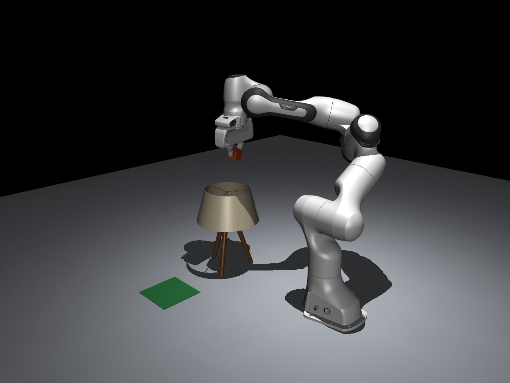

# Recovera

Recovera is a MuJoCo test bed for studying pick-and-place execution, failure detection, and bounded recovery with a Franka Panda. Five deterministic scenarios use the same task, monitoring, planning, and verification pipeline. An optional local Ollama model can choose among application-defined recovery strategies; it never supplies robot commands or trajectories.



*A captured frame from a successful obstacle-replanning run. The lamp separates pickup and placement; the Panda carries the cube above its shade.*

## Start here

Python 3.10 or newer is required. From the project directory:

```bash
python3 -m venv .venv
source .venv/bin/activate
python -m pip install --upgrade pip
python -m pip install -e '.[dev]'
```

Run the interactive menu, or start one scenario directly:

```bash
recovera
recovera --scenario obstacle-replan --llm-provider mock
```

The mock provider is deterministic and requires no model service. On macOS, use MuJoCo's bundled Python launcher to open the native viewer:

```bash
mjpython -m recovera.cli --viewer --scenario obstacle-replan --llm-provider mock
```

Use `--no-llm` to run a scenario with the deterministic policy. Each completed run writes a JSON record under `results/`; pass `--results-dir PATH` to change the output directory.

## Scenarios

| ID | Scenario | Demonstration |
|---|---|---|
| `baseline` | Normal Pick and Place | Executes and verifies the task without an injected failure or LLM guidance. |
| `drop-demo` | Mid-Air Drop | Releases the cube during lift, detects the drop, then attempts a bounded regrasp and task resumption. |
| `obstacle-replan` | Obstacle Avoidance | Places a table lamp between pickup and placement. Collision checks reject blocked configurations; seeded IK alternatives and the joint-space planner search for a feasible route. |
| `blocked-route` | Blocked Route | Uses a wall fixture to verify a blocked approach and leave the resting cube untouched. |
| `beyond-reach` | Drop Beyond Reach | Drops the cube outside the supported grasp workspace and checks that recovery stops safely. |

Run the obstacle demonstration in the native viewer with mock inference:

```bash
mjpython -m recovera.cli --viewer --scenario obstacle-replan --llm-provider mock
```

The obstacle scene starts the cube at `(0.45, -0.20, 0.018)` m and places the target at `(0.45, 0.32, 0)` m, with the lamp at `(0.45, 0.03, 0)` m. The lamp sits between the pickup and placement points, slightly toward the pickup side. The table lamp is a 0.65-scale public-domain model. Its visual meshes are separate from the collision geometry: the planner checks a cylindrical shade proxy and three capsule leg proxies. This keeps the scene recognizable while making collision checks tractable.

The obstacle viewer opens with a camera framing the pickup, lamp, and placement area. To regenerate the mid-transport image from a real simulation run:

```bash
PYTHONPATH=src python scripts/capture_obstacle_hero.py
```


## Local language-model guidance

LLM guidance is optional and runs through a local Ollama endpoint. Recovera sends bounded task and simulation state with a list of permitted strategies. The model can select a strategy or abstain; the application validates the response and independently plans, validates, executes, and verifies any proposed recovery. No prompt response can directly set joint positions or issue simulator controls.

Start Ollama and make a model available separately, then check it and run a scenario:

```bash
ollama serve
ollama pull llama3.2:3b
recovera --check-llm --llm-provider ollama --llm-model llama3.2:3b
recovera --scenario drop-demo --llm --llm-provider ollama --llm-model llama3.2:3b
```

Use `--llm-fallback deterministic` for the configured deterministic fallback or `--llm-fallback stop` to stop when the provider fails or returns an invalid proposal. An explicit model abstention, stale state, or failed planning check does not trigger unsafe execution. The provider accepts loopback HTTP endpoints only. See [LLM guidance](docs/llm-guidance.md) for the request boundary and operating details.

## Architecture

- `config.py` validates trial settings.
- `environment.py` builds the MuJoCo scene, resets state, and publishes supported scene revisions.
- `robot.py` maps the Panda's named joints, actuators, gripper, and fingertip contacts.
- `task.py` sequences the pick, lift, transfer, and placement waypoints.
- `monitoring.py` detects supported failed-grasp, dropped-object, and scene-change events from simulation state.
- `motion.py` implements IK, collision-aware joint-space RRT planning, trajectory validation, and execution.
- `recovery.py` evaluates permitted recovery candidates and records strategy outcomes.
- `llm.py` defines the bounded Ollama and deterministic mock providers.
- `verification.py` checks placement geometry and stability.
- `scenarios.py` defines the five benchmark configurations.
- `runner.py` and `cli.py` provide trial lifecycle and command-line entry points.

For the state flow, collision-checking assumptions, reproducibility, and limits, see [Simulation notes](docs/simulation.md). A representative successful mock-provider trial record is in [docs/examples/obstacle-replan-trial.json](docs/examples/obstacle-replan-trial.json).

## Tests

Run the headless test suite and lint checks:

```bash
python -m pytest -q
ruff check src tests
```

The real-model smoke test is skipped by default. It can be enabled when Ollama and the selected model are already available; instructions are in [Development](docs/development.md).

## Assets and license

Recovera's code is released under the [MIT License](LICENSE). The included Franka Panda model and its meshes retain their upstream Apache-2.0 license and notices in `assets/franka_emika_panda/`. The table lamp is dedicated to the public domain under CC0 1.0; its source and conversion notes are in `assets/obstacles/table_lamp/ASSET_INFO.txt`. See [third-party notices](NOTICE.md) for the asset sources and terms.

## Scope

Recovera is a simulation research prototype. It does not include perception, hardware drivers, or real-robot safety controls. MuJoCo collision checks use discrete samples along a path, and the lamp collision geometry is an approximation of its imported mesh. A successful simulation is evidence about this configured model and task, not a guarantee of physical performance.
